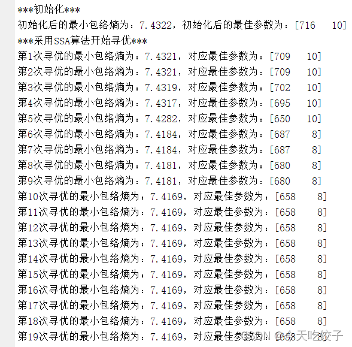
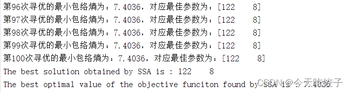
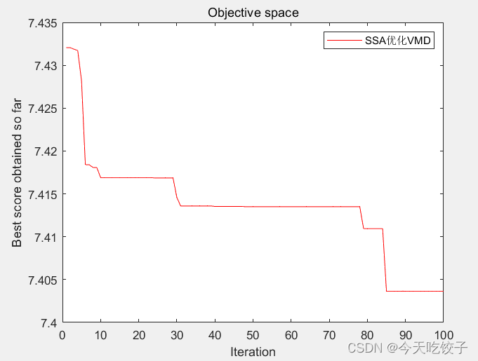

# Sparrow Algorithm SSA, Optimizing VMD, 6 Differentiable Fitness Functions, Including MATLAB Source Code.

The selection of charges is in direct opposition to the original intention of the author. However, due to the discovery that many people are directly using unauthorized materials for commercial purposes, even engaging in malicious competition, the author has decided to charge a fee for organizing and compiling these resources. We kindly ask for your understanding.

## Images

<!-- PAYMENT_BLOCK -->

## Get this dataset

- Payment link (Stripe): [Buy now](https://buy.stripe.com/3cs8yP7sY87d0vu9AB)
- Payment QR code: 

<!-- /PAYMENT_BLOCK -->
